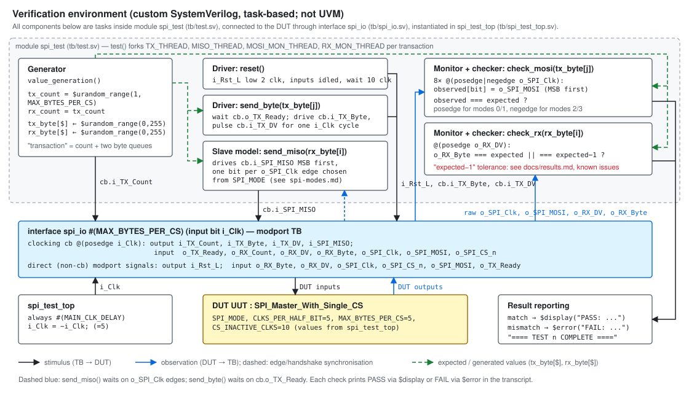
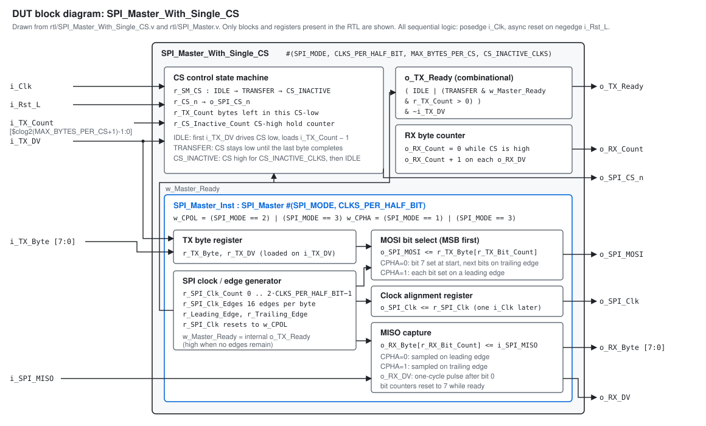
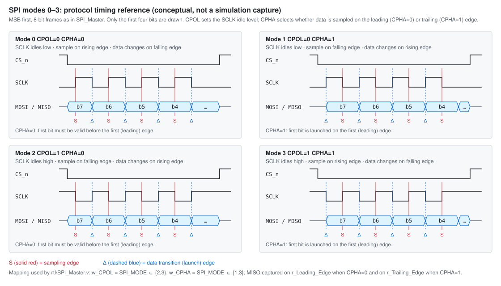
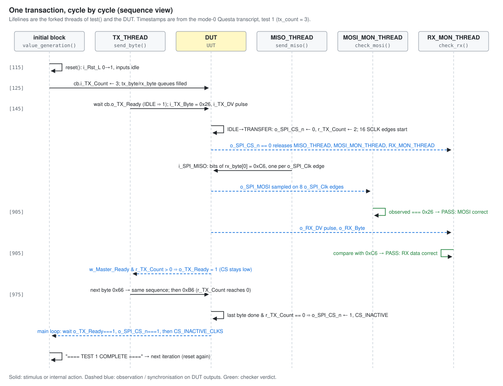
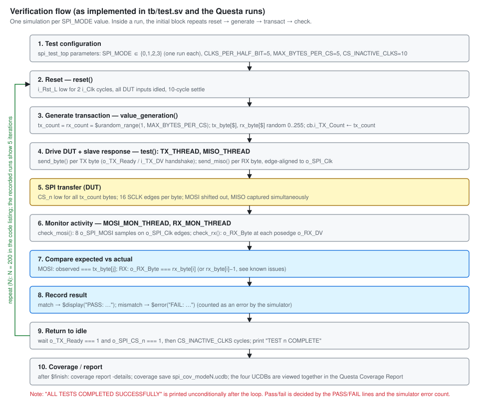
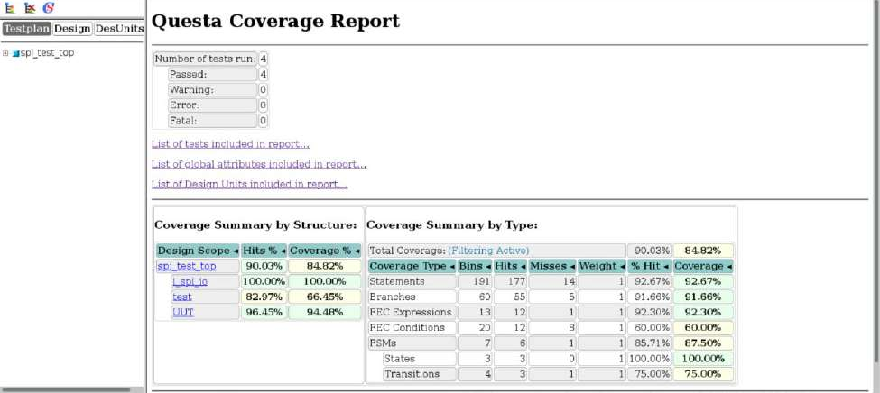
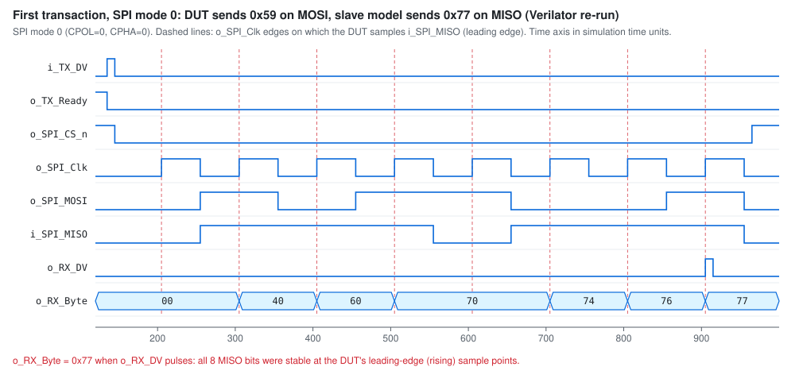

# SPI Master Verification with SystemVerilog


A self-checking SystemVerilog testbench for an SPI master with a single chip
select (`SPI_Master_With_Single_CS`). The environment runs randomized
multi-byte, full-duplex transactions in **all four CPOL/CPHA modes**. It
checks every transmitted MOSI byte and every received byte automatically,
and collects Questa code coverage.

| | |
|---|---|
| **DUT** | SPI master, single active-low CS, modes 0–3, up to `MAX_BYTES_PER_CS` bytes per CS-low |
| **Environment** | Custom task-based SystemVerilog (not UVM): generator · driver · slave model · monitor/checker |
| **Stimulus** | Random byte count (1–5) and random payload in both directions (`$urandom_range`) |
| **Checking** | MOSI rebuilt from SCLK-edge samples; `o_RX_Byte` compared on `o_RX_DV`; `$error` on mismatch |
| **Modes run** | 0, 1, 2, 3, one Questa run each, 5 transactions / 17 bytes per direction per mode |
| **Result** | 136 byte checks, 0 FAIL ([details and known issues](docs/results.md)) |
| **Code coverage** | 90.03% total (Hits %), DUT 96.45% (Questa, 4 merged runs) |

<p align="center">
  
</p>

---

## Contents

[Project Overview](#project-overview) ·
[Verification Objectives](#verification-objectives) ·
[DUT](#dut) ·
[Interface](#interface) ·
[SPI Protocol Background](#spi-protocol-background) ·
[Verification Environment](#verification-environment-architecture) ·
[Verification Plan](#verification-plan) ·
[SPI Mode Verification](#spi-mode-verification) ·
[Randomized Verification](#randomized-verification) ·
[Coverage](#coverage) ·
[Waveform Analysis](#waveform-analysis) ·
[Simulation](#simulation) ·
[Results](#results) ·
[Failure Debugging](#failure-debugging) ·
[Limitations](#limitations) ·
[Future Improvements](#future-improvements)

---

## Project Overview

**SPI** (Serial Peripheral Interface) is a synchronous, full-duplex serial
bus. The master generates the serial clock (SCLK), selects a slave by
pulling its chip select (CS) low, and shifts data out on MOSI while it
shifts data in on MISO, one bit per SCLK period.

The **DUT** (`rtl/`) is an SPI master that turns a byte-wide
ready/valid interface (`i_TX_Byte` / `i_TX_DV` / `o_TX_Ready`) into SPI
transfers. It also returns each received byte on `o_RX_Byte` with a
one-cycle `o_RX_DV` strobe. CS stays low for a programmable number of bytes
(`i_TX_Count`) and is then held high for `CS_INACTIVE_CLKS` cycles.

**Why the modes matter.** CPOL and CPHA decide the idle clock level and
which edge launches and which edge samples data. A master and slave that
disagree on the mode will both see valid-looking clocks and data, but
every byte will be shifted by half a bit or by one bit. Each mode therefore
needs its own check that MOSI is launched and MISO is captured on the
correct edges.

**What the environment checks.** For every transaction it:

- drives random bytes into the DUT through the TX handshake,
- plays the slave by driving random bytes onto MISO on the mode-specific
  edges,
- rebuilds each MOSI byte from the SCLK edges and compares it with the byte
  sent, and
- compares each `o_RX_Byte` (on `o_RX_DV`) with the byte the slave model
  sent.

Results are reported as PASS lines or `$error` in the simulator transcript.

> **Provenance.** This repository was rebuilt from the project report
> *"Verification of SPI Controller with Clock Polarity/Phase Modes"*
> (BEVD205L Scripting Languages and Verification). The testbench was
> transcribed from the report's code listings. The RTL is the open-source
> design the report cites (nandland/spi-master, MIT). The waveforms,
> transcripts and coverage are the report's Questa screenshots. The
> evidence audit in [docs/audit.md](docs/audit.md) lists what comes from
> where, and where the report and the code disagree.

## Verification Objectives

From the report's objectives, with how far each is covered by the actual
testbench (full status in [docs/verification-plan.md](docs/verification-plan.md)):

| Objective | Coverage in this testbench |
|---|---|
| MOSI transmission correctness | Self-checked per byte (`check_mosi`) |
| MISO reception → `o_RX_Byte` / `o_RX_DV` | Self-checked per byte (`check_rx`); weakened in modes 1/3 (see [known issues](docs/results.md#known-issues)) |
| Chip-select assertion/de-assertion per transaction | Exercised; visible in waveforms; not auto-checked |
| SCLK frequency, polarity (CPOL) and phase (CPHA) per mode | Four mode runs; edge behaviour is checked through the data checks; frequency not measured |
| Multi-byte transfers under one CS-low period | Self-checked data for 2-, 3- and 4-byte transfers |
| `o_TX_Ready` allows loading the next byte | Exercised by the driver handshake |
| Reset returns the DUT to idle | Reset applied before every transaction; not auto-checked |
| Continuous transfers without corruption | Exercised inside multi-byte transfers |
| Self-checking data integrity | Yes: PASS / `$error` per byte |
| Repeatable, automated randomized runs | Yes: randomized loop; same default seed every run |

## DUT

<p align="center">
  
</p>

`SPI_Master_With_Single_CS` wraps `SPI_Master`:

| Block | RTL | Function |
|---|---|---|
| CS state machine | `r_SM_CS` ∈ {`IDLE`, `TRANSFER`, `CS_INACTIVE`}, `r_CS_n`, `r_TX_Count`, `r_CS_Inactive_Count` | Pulls CS low on the first `i_TX_DV`, keeps it low until `i_TX_Count` bytes are done, then holds it high for `CS_INACTIVE_CLKS` |
| TX-ready gating | combinational `o_TX_Ready` | Ready in IDLE, or in TRANSFER when the core is idle and bytes remain; forced low while `i_TX_DV` is high |
| RX counter | `o_RX_Count` | Index of received bytes in the current CS-low period |
| SPI clock / edge generator | `r_SPI_Clk_Count`, `r_SPI_Clk_Edges` (16 per byte), `r_Leading_Edge`, `r_Trailing_Edge`, `r_SPI_Clk` | SCLK = `i_Clk` / (2·`CLKS_PER_HALF_BIT`), idle level = CPOL |
| MOSI bit select | `r_TX_Byte`, `r_TX_Bit_Count` | MSB first; launch edge set by CPHA |
| MISO capture | `o_RX_Byte[r_RX_Bit_Count]`, `o_RX_DV` | Sample edge set by CPHA; one-cycle `o_RX_DV` after bit 0 |
| Clock alignment | `o_SPI_Clk <= r_SPI_Clk` | Aligns the SCLK pin with the MOSI update and MISO sample |

The report describes the DUT as using "shift registers". The RTL actually
uses byte registers indexed by down-counting bit counters, which behave the
same way.

## Interface

### Ports (`rtl/SPI_Master_With_Single_CS.v`)

| Signal | Direction | Width | Description |
|---|---|---:|---|
| `i_Rst_L` | input | 1 | Asynchronous active-low reset |
| `i_Clk` | input | 1 | System clock. Must be at least 2× SCLK. |
| `i_TX_Count` | input | `$clog2(MAX_BYTES_PER_CS+1)` (3 in TB) | Number of bytes to send in this CS-low period. Registered on the first `i_TX_DV` in IDLE. |
| `i_TX_Byte` | input | 8 | Byte to transmit on MOSI |
| `i_TX_DV` | input | 1 | One-cycle valid pulse for `i_TX_Byte` |
| `o_TX_Ready` | output | 1 | High when the next byte can be accepted |
| `o_RX_Count` | output | `$clog2(MAX_BYTES_PER_CS+1)` (3 in TB) | Running index of received bytes. Cleared while CS is high. |
| `o_RX_DV` | output | 1 | One-cycle pulse: `o_RX_Byte` holds a complete byte |
| `o_RX_Byte` | output | 8 | Byte received on MISO |
| `o_SPI_Clk` | output | 1 | SPI clock (SCLK) |
| `i_SPI_MISO` | input | 1 | Serial data from the slave |
| `o_SPI_MOSI` | output | 1 | Serial data to the slave |
| `o_SPI_CS_n` | output | 1 | Active-low chip select |

### Parameters

| Parameter | RTL default | Testbench value | Meaning |
|---|---:|---:|---|
| `SPI_MODE` | 0 | 0, 1, 2, 3 (one run each) | CPOL = mode∈{2,3}, CPHA = mode∈{1,3} |
| `CLKS_PER_HALF_BIT` | 2 | 5 | `i_Clk` cycles per SCLK half-period (≥ 2) |
| `MAX_BYTES_PER_CS` | 2 | 5 | Maximum bytes per CS-low period. Sets the count widths. |
| `CS_INACTIVE_CLKS` | 1 | 10 | `i_Clk` cycles CS is held high after a transfer |
| `MAIN_CLK_DELAY` (TB only) | — | 5 | Half-period of `i_Clk` in `spi_test_top` |

With these values, SCLK runs at `i_Clk`/10 and one byte takes 80 `i_Clk` cycles.

## SPI Protocol Background

| Line | Driven by | Purpose |
|---|---|---|
| SCLK (`o_SPI_Clk`) | master | Bit clock. Toggles only during a transfer. |
| CS (`o_SPI_CS_n`) | master | Active-low slave select. Frames the transfer. |
| MOSI (`o_SPI_MOSI`) | master | Master Out, Slave In |
| MISO (`i_SPI_MISO`) | slave | Master In, Slave Out |

- **CPOL** is the idle level of SCLK: 0 = idle low, 1 = idle high.
- **CPHA** selects the sampling edge: 0 = sample on the leading edge (data
  must be valid before the first edge); 1 = launch on the leading edge and
  sample on the trailing edge.

| Mode | CPOL | CPHA | Idle Clock | Sampling Edge | Data Transition Edge |
|---|---:|---:|---|---|---|
| 0 | 0 | 0 | Low | Rising | Falling |
| 1 | 0 | 1 | Low | Falling | Rising |
| 2 | 1 | 0 | High | Falling | Rising |
| 3 | 1 | 1 | High | Rising | Falling |

This matches the DUT: MISO is captured on `r_Leading_Edge` when CPHA = 0 and
on `r_Trailing_Edge` when CPHA = 1. MOSI changes on the opposite edge, and
for CPHA = 0 bit 7 is pre-loaded before the first edge.

<p align="center">
  
</p>

## Verification Environment Architecture

All components are `automatic` tasks in module `spi_test` (`tb/test.sv`).
They connect to the DUT through interface `spi_io` (`tb/spi_io.sv`) and its
`posedge i_Clk` clocking block. Full walkthrough:
[docs/testbench-architecture.md](docs/testbench-architecture.md).

```
value_generation()  ──►  send_byte()  ──► spi_io.cb ──►  DUT  ──► o_SPI_MOSI ──►  check_mosi() ──► PASS / $error
   (generator)            (driver)                       │ ▲                      (monitor+checker)
        │                 send_miso() ──► i_SPI_MISO ────┘ └── o_RX_Byte, o_RX_DV ──► check_rx() ──► PASS / $error
        └── expected tx_byte[$] / rx_byte[$] ───────────────────────────────────────────────▲
```

### Generator

`value_generation()` clears the `tx_byte[$]` and `rx_byte[$]` queues. It
draws `tx_count = $urandom_range(1, MAX_BYTES_PER_CS)` and sets
`rx_count = tx_count`, programs `i_TX_Count`, and fills both queues with
`$urandom_range(0,255)` bytes. The main loop calls it once per iteration,
so each transaction gets a new length and payload. There is no transaction
class and no `constraint` block. The bounds of `$urandom_range` are the
only constraints.

### Driver

| Task | What it drives | Synchronisation |
|---|---|---|
| `reset()` | All inputs to 0, `i_Rst_L` low 2 cycles, then 10 settle cycles | `@(spi_io.cb)` |
| `send_byte()` | `i_TX_Byte`, one-cycle `i_TX_DV` | Waits for `cb.o_TX_Ready` |
| `send_miso()` (slave model) | `i_SPI_MISO`, MSB first | `o_SPI_Clk` edges selected by `SPI_MODE` |

`send_miso()` drive points, which match the report's driver description:

| Mode | MISO changes after | Report wording |
|---|---|---|
| 0 | bit 7 immediately, then each **falling** edge | "drive on falling, sample on rising" |
| 1 | each **rising** edge | "drive on rising, sample on falling" |
| 2 | bit 7 immediately, then each **rising** edge | "idle high, drive on rising" |
| 3 | each **falling** edge | "idle high, drive on falling" |

```systemverilog
// send_miso(), CPHA = 1 path (modes 1 and 3)
drive_on_posedge = !((SPI_MODE == 0) || (SPI_MODE == 3));
for (int i = 7; i >= 0; i--) begin
  if (drive_on_posedge) @(posedge spi_io.o_SPI_Clk);
  else                  @(negedge spi_io.o_SPI_Clk);
  spi_io.cb.i_SPI_MISO <= miso_data[i];
end
```

### Monitor

The monitor tasks only **read** DUT outputs, through the modport's input
signals. They never assign anything, so they cannot disturb the DUT.

- `check_mosi()` waits for 8 `o_SPI_Clk` edges (posedge for modes 0/1,
  negedge for modes 2/3) and rebuilds the byte MSB first from `o_SPI_MOSI`.
- `check_rx()` waits for `posedge o_RX_DV` and reads the parallel
  `o_RX_Byte`.

The edge choice depends on CPOL only. For CPHA = 1 that edge is the DUT's
launch edge, as described in
[docs/spi-modes.md](docs/spi-modes.md#observations-from-the-audit).

### Checker

The checks are tasks that compare as soon as they sample. There is no
separate scoreboard storage.

```
tx_byte[j] (expected) ─┐                       rx_byte[i] (expected) ─┐
                       ▼                                              ▼
         observed === expected ?                 o_RX_Byte === expected (|| expected−1) ?
                       ▲                                              ▲
 MOSI bits sampled on SCLK edges (actual)        o_RX_Byte at posedge o_RX_DV (actual)
                       │                                              │
            PASS: $display / FAIL: $error                PASS: $display / FAIL: $error
```

The failure message prints the time, the expected value and the observed
value. The `expected − 1` tolerance in `check_rx()` comes from the original
code and is discussed under [known issues](docs/results.md#known-issues).

### Test sequencing

`test()` forks four threads per transaction: `TX_THREAD`, `MISO_THREAD`,
`MOSI_MON_THREAD` and `RX_MON_THREAD`. The last three start when
`o_SPI_CS_n` falls. Transmit, receive and both checks therefore run
concurrently, as on a real full-duplex bus. The main `initial` block loops
reset → generate → `test()` → wait for idle → `CS_INACTIVE_CLKS` gap.

<p align="center">
  
</p>

## Verification Plan

Full matrix with stimulus, expected behaviour and actual result:
[docs/verification-plan.md](docs/verification-plan.md).

| Test | Result |
|---|---|
| MOSI data, all modes | **Passed** (self-checked, 68 bytes) |
| RX data, modes 0/2 | **Passed** (self-checked, 34 bytes) |
| RX data, modes 1/3 | **Partial**: passes, but bit 0 is not validated |
| Multi-byte transfer (2–4 bytes per CS-low) | **Passed** (data); CS framing observed |
| Continuous bytes inside one CS-low | Exercised |
| Reset, idle bus, TX-ready, SCLK frequency, `o_RX_Count` | Exercised / observed, not auto-checked |
| 1-byte and 5-byte transactions, directed patterns, back-to-back without reset | Not tested |

<p align="center">
  
</p>

## SPI Mode Verification

Each mode was a separate simulation with `SPI_MODE` set in `spi_test_top`.
Detailed per-mode RTL and testbench edge tables:
[docs/spi-modes.md](docs/spi-modes.md).

| Mode | CPOL/CPHA | Idle | DUT drives MOSI on | DUT samples MISO on | Tested | Observed | Status |
|---|---|---|---|---|---|---|---|
| 0 | 0/0 | low | falling (bit 7 pre-loaded) | rising | 5 transactions | 34 PASS, 0 FAIL | Passed |
| 1 | 0/1 | low | rising | falling | 5 transactions | 34 PASS, 0 FAIL | Passed (RX bit 0 not validated) |
| 2 | 1/0 | high | rising (bit 7 pre-loaded) | falling | 5 transactions | 34 PASS, 0 FAIL | Passed |
| 3 | 1/1 | high | falling | rising | 5 transactions | 34 PASS, 0 FAIL | Passed (RX bit 0 not validated) |

## Randomized Verification

- **Mechanism:** `$urandom_range(1, MAX_BYTES_PER_CS)` for the transaction
  length, and `$urandom_range(0,255)` for every MOSI and MISO byte.
- **Scale in the recorded runs:** 5 transactions per mode. The lengths were
  3, 2, 4, 4 and 4, giving 17 random bytes in each direction.
- **Why randomize here:** the payload space (256 values per byte, both
  directions at once) and the length space are too large to cover by hand.
  Random values exercise arbitrary bit patterns and alternating bits on
  MOSI/MISO without writing vectors. Because the checkers compute expected
  values from the same queues, every random byte is still checked
  automatically.
- **Repeatability:** without an explicit seed, Questa uses its default seed.
  That made every run reproducible, but it also meant all four modes saw
  identical data, and lengths 1 and 5 never occurred. Varying
  `-sv_seed` and adding length coverage would address this (see
  [future improvements](#future-improvements)).

This is randomized testing over a small sample. It is not exhaustive.

## Coverage

<p align="center">
  
</p>

| Metric (Questa, 4 merged runs) | Hits % | Coverage % |
|---|---:|---:|
| Total (`spi_test_top`) | **90.03%** | 84.82% |
| DUT (`UUT`) | **96.45%** | 94.48% |
| Statements | 92.67% | 92.67% |
| Branches | 91.66% | 91.66% |
| FEC expressions | 92.30% | 92.30% |
| FEC conditions | 60.00% | 60.00% |
| FSM states / transitions | 100% / 75% | 87.50% (FSM) |

All of these are **code coverage**. The testbench contains no covergroups
or assertions. The report's "functional coverage > 95%" therefore has no
supporting evidence and is not claimed here. Interpretation and limitations:
[docs/coverage.md](docs/coverage.md).

## Waveform Analysis

<p align="center">
  
</p>

*Questa waveform, SPI mode 0, the complete run of 5 transactions. The
signals shown include `i_Rst_L`, `i_TX_Count` (3, 2, 4, 4, 4), `i_TX_Byte`
(0x26, 0x66, 0xB6, …), `i_TX_DV`, `i_SPI_MISO`, `o_TX_Ready`, `o_RX_Count`,
`o_RX_DV`, `o_RX_Byte`, `o_SPI_Clk`, `o_SPI_MOSI`, `o_SPI_CS_n` and the
testbench's `test_count`. Each CS-low window contains `i_TX_Count` bursts of
SCLK, with one `o_RX_DV` pulse and an `o_RX_Count` increment per byte.*

For an edge-level view, the first transaction (`0x59` out on MOSI, `0x77`
in on MISO) was re-simulated and rendered from the VCD. Red dashed lines
mark the edges on which the DUT samples MISO:

<p align="center">
  
</p>

In mode 0, MOSI and MISO change on falling edges and are sampled on rising
edges. Bit 7 (`0`) is on MOSI before the first rising edge. `o_RX_Byte`
builds up `40 → 60 → 70 → 74 → 76 → 77`, and `o_RX_DV` pulses once at
the end. The mode 1 version of the same figure, showing the bit-0 issue,
is in [docs/spi-modes.md](docs/spi-modes.md#observations-from-the-audit).
These two figures come from a Verilator re-run, not from the report's
Questa runs ([why](docs/results.md#open-source-re-run)).

Per-mode Questa waveforms and transcripts are in
[`results/`](results/README.md).

## Testbench Code Walkthrough

| File | Role | Important contents |
|---|---|---|
| [`tb/spi_test_top.sv`](tb/spi_test_top.sv) | Top | Clock, parameters, `spi_io`, `spi_test` and `UUT` instances |
| [`tb/spi_io.sv`](tb/spi_io.sv) | Interface | DUT signals, `clocking cb @(posedge i_Clk)`, `modport TB` |
| [`tb/test.sv`](tb/test.sv) | Test | `value_generation`, `reset`, `send_byte`, `send_miso`, `check_mosi`, `check_rx`, `test`, main loop |
| [`rtl/SPI_Master_With_Single_CS.v`](rtl/SPI_Master_With_Single_CS.v) | DUT top | CS FSM, counts, `o_TX_Ready` |
| [`rtl/SPI_Master.v`](rtl/SPI_Master.v) | DUT core | SCLK/edge generation, MOSI, MISO |

Details: [docs/testbench-architecture.md](docs/testbench-architecture.md).

## Simulation

The original project was run with **Siemens (Mentor) Questa Sim**, which is
a licensed commercial tool. No Questa licence was available while preparing
this repository, so the Questa commands below have **not** been re-run
here. The recorded results come from the report.

### Compilation

```sh
cd sim
vlib work
vlog -sv +cover=sbecf ../rtl/SPI_Master.v ../rtl/SPI_Master_With_Single_CS.v \
     ../tb/spi_io.sv ../tb/test.sv ../tb/spi_test_top.sv
```

The compile options are not shown in the report. `+cover=sbecf` enables the
statement, branch, expression, condition and FSM coverage that appear in
the coverage report.

### Elaboration and simulation

The command from the report's transcripts. Set `SPI_MODE` with
`-GSPI_MODE=<n>`, or edit `spi_test_top.sv` as in the original runs:

```sh
vsim -coverage -novopt -GSPI_MODE=0 \
     -do "view wave; add wave -radix hex -r *; run -all; coverage report -details; coverage save spi_cov_mode0.ucdb" \
     spi_test_top
```

### Waveform viewing

The `-do` string above opens the Wave window and adds all signals
(`add wave -radix hex -r *`).

### Coverage collection

```sh
vcover merge spi_cov_merged.ucdb spi_cov_mode0.ucdb spi_cov_mode1.ucdb spi_cov_mode2.ucdb spi_cov_mode3.ucdb
vcover report -html -htmldir spi_cov_report spi_cov_merged.ucdb
```

`sim/scripts/run_questa.sh` runs all four modes in batch mode and then
merges coverage.

### Open-source cross-check (experimental)

```sh
sim/scripts/run_verilator.sh 0     # tested with Verilator 5.48 (5.020 rejects the interface); needs a C++20 compiler
python3 sim/scripts/vcd_to_svg.py sim/build_verilator_mode0/dump.vcd --start 120 --end 1000 --mode 0 -o wave.svg
```

This compiles and runs the first transaction in each mode with output that
matches the Questa transcripts. Multi-byte transactions diverge because of
clocking-block drive semantics, so this flow is for waveform inspection
only ([details](docs/results.md#open-source-re-run)).

## Results

Full results and evidence: [docs/results.md](docs/results.md).

| Metric | Result | Kind |
|---|---|---|
| SPI modes simulated | 0, 1, 2, 3 | Tested |
| Transactions | 5 per mode, 20 total | Tested |
| MOSI byte checks | 68 / 68 PASS | Passed |
| RX byte checks | 68 / 68 PASS (modes 1/3 weakened) | Passed / Partial |
| Multi-byte transfer | 2-, 3- and 4-byte CS-low transfers | Passed (data) |
| Reset | Before every transaction | Observed |
| Code coverage, total | 90.03% Hits % / 84.82% Coverage % | Measured |
| Code coverage, DUT | 96.45% Hits % / 94.48% Coverage % | Measured |
| Functional coverage | Not implemented | — |
| Questa test status (merged) | 4 run, 4 passed, 0 errors | Measured |

### Known issues found during the audit

1. `check_rx()` accepts `o_RX_Byte === expected − 1` as a pass.
2. In CPHA = 1 modes (1, 3), `send_miso()` releases MISO one `i_Clk` after
   driving bit 0. The DUT samples bit 0 five `i_Clk` cycles later, on the
   trailing edge, so bit 0 is received as 0. Issue 1 hides this for odd
   bytes.
3. `check_mosi()` samples on the leading edge in every mode, which is the
   launch edge when CPHA = 1.
4. The listing says `repeat (200)`; the recorded runs executed 5
   iterations.

None of these is a DUT defect. Details and a suggested fix:
[docs/results.md](docs/results.md#known-issues).

## Failure Debugging

```
Mismatch ($error with time, expected, got)
  → Identify transaction   (preceding "TX Count / TX Bytes / RX Bytes" lines, test_count)
  → Check expected data    (tx_byte[j] / rx_byte[i])
  → Check MOSI / MISO      (bit by bit, MSB first)
  → Check CS               (o_SPI_CS_n low for the whole transaction)
  → Check CPOL / CPHA      (SPI_MODE, o_SPI_Clk idle level)
  → Check edge alignment   (where data changed vs. which edge was sampled)
  → Check DUT state        (r_SM_CS, r_TX_Count, r_SPI_Clk_Edges, bit counters, edge strobes)
  → Locate root cause      (DUT, driver/monitor timing, or stimulus)
```

Known issue 2 is a worked example of this flow. Without the tolerance, the
failure reads `exp=0x77 got=0x76`. The waveform then shows `i_SPI_MISO`
dropping before the 8th trailing edge, which points to the slave model
rather than the DUT.

## Why This Verification Environment

- **Generator separated from driving.** Lengths and payloads are produced
  in one place and stored. The same values feed the drivers and become the
  checkers' expected values, so stimulus and checking cannot drift apart.
- **Driver through a clocking block.** Inputs change relative to
  `posedge i_Clk`, so the testbench does not race the DUT's sequential
  logic.
- **A slave model, not just a master driver.** The DUT is a master, so
  MISO stimulus must follow the DUT's own SCLK. `send_miso()` waits on
  `o_SPI_Clk` edges instead of a fixed `i_Clk` count.
- **Passive monitors and automatic checks.** Every byte is compared in
  both directions without manual waveform inspection, and mismatches go
  through `$error`, so the simulator's error count reflects them.
- **Mode-aware timing.** Drive and sample edges are derived from
  `SPI_MODE`, so one testbench covers all four modes by changing one
  parameter.
- **Concurrent threads.** Forking TX, MISO, and both checks matches the
  full-duplex protocol and catches TX/RX interaction issues within a
  transaction.

This is a lightweight module/task environment. It has no classes,
mailboxes or UVM phases. That is appropriate for one DUT and one protocol,
but it is not a reusable verification component.

## Lessons Learned

- **CPOL/CPHA errors look like data errors.** Sampling on the wrong edge
  shifts a byte by one bit. Checking data per mode is the practical way to
  check edge alignment.
- **Hold time matters in a slave model.** Releasing MISO one `i_Clk` after
  the launch edge works for CPHA = 0 but loses the last bit for CPHA = 1.
  The testbench model must respect the same timing contract as a real
  slave.
- **Tolerances in checkers hide bugs.** The `expected − 1` acceptance made
  modes 1 and 3 pass while bit 0 was never validated. A check should be
  exact, or the reason for relaxing it should be documented.
- **Sample on the protocol edge, not on the launch edge.** A monitor that
  happens to work because of nonblocking-assignment ordering is fragile
  across simulators and design changes.
- **TX and RX are one operation in SPI.** Every byte sent clocks a byte in,
  which is why the TX and RX counts are kept equal and checked in parallel.
- **A final "SUCCESS" banner is not a verdict.** Pass/fail must come from
  the checks and the simulator error count.
- **Random needs seeds and coverage.** Without seed variation and length
  coverage, "random" runs repeated the same 20 transactions and missed the
  1- and 5-byte boundaries.

## Limitations

- No UVM; no classes or transaction objects.
- No SystemVerilog Assertions, so CS framing, `o_RX_DV` pulse width,
  `o_TX_Ready` timing, idle levels and SCLK period are not checked
  automatically.
- No functional coverage model (covergroups).
- No constrained-random `rand`/`constraint` stimulus; fixed seed; 5
  transactions per mode in the recorded runs.
- `SPI_MODE` is a compile-time parameter: one mode per simulation, with no
  mode changes within a run.
- Reset between every transaction, so back-to-back CS cycles without reset
  are not tested.
- No error injection, no timeout/watchdog (a missing `o_RX_DV` would hang
  the run), and no `CLKS_PER_HALF_BIT` or `MAX_BYTES_PER_CS` sweep.
- Single slave and 8-bit words only, as the DUT supports.
- Known issues 1–3 above.
- Results come from the report's screenshots. No text logs or UCDB files
  are available.

## Future Improvements

*Future work. None of this is implemented in this repository.*

- Fix the CPHA = 1 MISO hold time in `send_miso()`, remove the
  `expected − 1` tolerance, and sample MOSI on the CPHA-correct edge.
- SVA for CS framing, one `o_RX_DV` per byte, `o_TX_Ready` behaviour, SCLK
  idle level per CPOL, and SCLK half-period = `CLKS_PER_HALF_BIT`.
- Covergroups for mode × transaction length (1..`MAX_BYTES_PER_CS`) ×
  data patterns (0x00, 0xFF, 0xA5, 0x5A), with cross coverage.
- Seed control (`-sv_seed`) with the seed printed in the log, and a
  regression script looping over modes × seeds.
- Directed tests: 1-byte and `MAX_BYTES_PER_CS`-byte transfers,
  back-to-back transactions without reset, and reset during a transfer.
- A timeout watchdog, and a final pass/fail summary computed from error
  counters.
- A class-based or UVM environment if the DUT grows, for example to
  multiple chip selects.
- Automated regression reporting (merged UCDB, per-test status table).

## Conclusion

The `SPI_Master_With_Single_CS` DUT was simulated in all four SPI modes
with a self-checking, task-based SystemVerilog testbench. Randomized
multi-byte transactions drove MOSI through the DUT's ready/valid interface,
and a mode-aware slave model returned random MISO data. Every transmitted
byte (68/68) and every received byte (68/68) passed its automatic check,
and Questa reported 90.03% total code coverage (Hits %), with 96.45% on the
DUT. The audit also found that the receive check in modes 1 and 3 is
weaker than its PASS lines suggest, and that functional coverage was never
implemented. Those two items, plus assertions and seed/length coverage, are
the next steps to make the verification complete.

## Repository Structure

```
spi-master-verification/
├── README.md
├── LICENSE
├── rtl/                        DUT (nandland/spi-master, MIT) + provenance note
├── tb/                         spi_test_top.sv, spi_io.sv, test.sv
├── sim/scripts/                run_questa.sh, run_verilator.sh, vcd_to_svg.py
├── coverage/                   coverage evidence index
├── results/
│   ├── waveforms/              Questa waveforms: reset, modes 0–3
│   └── logs/                   Questa transcripts: modes 0–3
├── docs/
│   ├── verification-plan.md
│   ├── testbench-architecture.md
│   ├── spi-modes.md
│   ├── coverage.md
│   ├── results.md
│   └── audit.md                report-vs-code evidence audit
└── assets/                     diagrams, waveform.png, coverage.png
```

## License

The testbench, scripts and documentation are released under the MIT License
([LICENSE](LICENSE)). The RTL in `rtl/` is © 2019 russell-merrick
(nandland), also under the MIT License ([rtl/LICENSE.nandland](rtl/LICENSE.nandland)).
