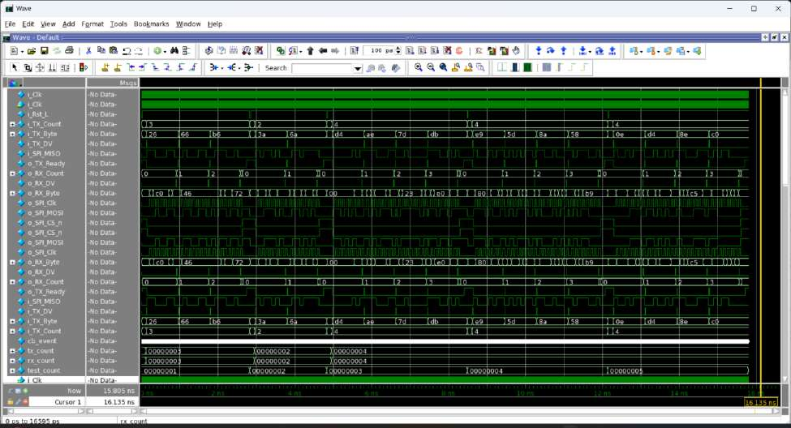

# Simulation Results

Every result here comes from the Questa Sim runs recorded in the project
report. Screenshots are copied to `results/` and `assets/`. Terms used:

- **Tested**: stimulus was applied in a recorded run.
- **Passed**: an automatic check compared expected vs actual and printed PASS, with no FAIL.
- **Observed**: visible in a waveform or log, but not checked automatically.
- **Measured**: a number produced by a tool (coverage).

## Simulator

| Item | Value | Source |
|---|---|---|
| Simulator | Questa Sim-64, Mentor Graphics (transcript banner: version 10.6, 2017) | Transcript header |
| Run command | `vsim -coverage -novopt -do "view wave;add wave -radix hex -r *;run -all; coverage report -details; coverage save spi_cov_mode<N>.ucdb" spi_test_top` | Transcript, one per mode |
| Runs | 4: `spi_cov_mode0.ucdb` … `spi_cov_mode3.ucdb` | Transcript command lines, coverage report "Number of tests run: 4" |
| Simulation end time | 15805 ps per run, at `$finish` | Transcript end |

## Per-mode results

All four runs used the same default seed, so they show the same stimulus:

| Test | `tx_count` | TX bytes (MOSI) | RX bytes (MISO) |
|---|---:|---|---|
| 1 | 3 | 0x26 0x66 0xB6 | 0xC6 0x46 0x72 |
| 2 | 2 | 0x3A 0x6A | 0xB4 0x6F |
| 3 | 4 | 0xD4 0xAE 0x7D 0xDB | 0x05 0xE3 0x20 0xE5 |
| 4 | 4 | 0xE9 0x5D 0x8A 0x58 | 0x8B 0x56 0xC9 0xB9 |
| 5 | 4 | 0x0E 0xD4 0x8E 0xC0 | 0x97 0x25 0xC7 0x58 |

*Decimal values from the `TX Bytes` / `RX Bytes` transcript lines, converted
to hex. The hex values match the `Sent MOSI byte` / `PASS` lines.*

| Mode | Transactions | MOSI byte checks | RX byte checks | FAIL lines | Final message | Status |
|---|---:|---:|---:|---:|---|---|
| 0 | 5 | 17 PASS | 17 PASS | 0 | `ALL TESTS COMPLETED SUCCESSFULLY` | Passed |
| 1 | 5 | 17 PASS | 17 PASS* | 0 | same | Passed* |
| 2 | 5 | 17 PASS | 17 PASS | 0 | same | Passed |
| 3 | 5 | 17 PASS | 17 PASS* | 0 | same | Passed* |

\* The RX check in modes 1 and 3 passes partly because of the
`expected − 1` tolerance. See known issues 1 and 2.

The "ALL TESTS COMPLETED SUCCESSFULLY" banner prints unconditionally after
the loop, so on its own it is not a pass indication. The pass evidence is:

1. Every check prints PASS in the transcripts, and no FAIL / `$error` line appears.
2. The merged coverage report shows *Passed: 4, Error: 0, Fatal: 0* for the four runs.

## Summary metrics

| Metric | Result | Kind |
|---|---|---|
| SPI modes simulated | 0, 1, 2, 3 (one run each) | Tested |
| Transactions per mode | 5 | Tested |
| Bytes per mode, each direction | 17 (lengths 3, 2, 4, 4, 4) | Tested |
| MOSI data integrity | 68/68 byte checks PASS | Passed |
| RX data integrity | 68/68 byte checks PASS (modes 1/3 weakened) | Passed / Partial |
| Multi-byte transfer under one CS-low | 2-, 3- and 4-byte transfers | Passed (data), Observed (CS) |
| Reset | Applied before every transaction | Observed |
| Code coverage, total (merged) | 90.03% Hits %, 84.82% Coverage % | Measured |
| Code coverage, DUT (`UUT`) | 96.45% Hits %, 94.48% Coverage % | Measured |
| Functional coverage | Not implemented | — |

## Waveform evidence



*Questa Wave window, SPI mode 0, full run (0–16.1 ns). Visible signals:
`i_Clk`, `i_Rst_L`, `i_TX_Count`, `i_TX_Byte`, `i_TX_DV`, `i_SPI_MISO`,
`o_TX_Ready`, `o_RX_Count`, `o_RX_DV`, `o_RX_Byte`, `o_SPI_Clk`,
`o_SPI_MOSI`, `o_SPI_CS_n`, plus the testbench variables `tx_count`,
`rx_count` and `test_count`. Five CS-low windows are visible, one per
transaction. `test_count` steps 1 → 5, and `i_TX_Count` takes the values
3, 2, 4, 4, 4. The first `i_TX_Byte` values are 0x26, 0x66, 0xB6.*

At this zoom level the individual SCLK edges cannot be resolved. For an
edge-level view see [spi-modes.md](spi-modes.md#observations-from-the-audit),
which shows the first transaction re-simulated and rendered from a VCD with
the DUT's sampling edges marked.

Other captures: `results/waveforms/mode{1,2,3}_waveform_questa.png` and
`results/waveforms/reset_waveform_questa.png`.

## Known issues

These come from reading the transcribed testbench against the RTL. They do
not change the recorded PASS results. They limit what those results prove.

### 1. `check_rx()` accepts `expected − 1`

```systemverilog
if ((spi_io.o_RX_Byte === (expected)) || (spi_io.o_RX_Byte === (expected-1)))
```

Any received byte one below the expected value passes. That masks issue 2,
and it would also mask a real off-by-one corruption in any mode, for example
0x10 received as 0x0F.

### 2. CPHA = 1 slave model drops bit 0 (modes 1 and 3)

In the CPHA = 1 branch, `send_miso()` drives bit 0 after the 8th leading
edge. It then waits one `i_Clk` and drives `i_SPI_MISO <= 0`. The DUT
samples bit 0 on the 8th trailing edge, `CLKS_PER_HALF_BIT` = 5 `i_Clk`
cycles later, so it always captures 0.

- Received byte = expected with bit 0 cleared.
- If expected is odd, the result is `expected − 1`, which passes only
  because of issue 1. 10 of the 17 RX bytes are odd, for example 0x6F,
  0x05, 0x8B and 0x97.
- If expected is even, the result matches exactly.

The PASS message prints the *expected* value, not `o_RX_Byte`, so the
transcripts cannot show this directly. The conclusion comes from the RTL and
testbench timing, plus the Verilator re-run below.

The re-simulation in [spi-modes.md](spi-modes.md#observations-from-the-audit)
shows this directly: `0x77` is sent and `o_RX_Byte = 0x76`.

**Suggested fix (not applied):** hold the last bit until the trailing edge,
for example by replacing the final `@(spi_io.cb)` with an `@` on the
opposite `o_SPI_Clk` edge. Then remove the `expected − 1` term from
`check_rx()`.

### 3. `check_mosi()` samples on the launch edge for CPHA = 1

See [spi-modes.md](spi-modes.md#observations-from-the-audit). The check
passes, but it relies on same-timestep nonblocking-assignment ordering
rather than the protocol sampling edge.

### 4. Listing vs. executed run

The code listing in the report has `repeat (200)`, but every transcript
shows exactly 5 tests before `$finish`. So the file that was simulated
differed from the listing at least in the iteration count. The repository
keeps `repeat (200)` as listed.

## Open-source re-run

No Questa licence was available while preparing this repository. The
reconstructed sources were therefore also run with **Verilator 5.48**
(`sim/scripts/run_verilator.sh`). Results:

- Compiles after one shim: `spi_io.TB` is replaced with the plain interface
  type in a build-directory copy, because Verilator rejects a modport that
  contains a clocking block.
- **First transaction, all four modes:** the log matches the Questa
  transcript pattern exactly: `[145] Sent MOSI byte`, `[905] PASS: MOSI
  correct`, `[905]`/`[955]` RX PASS and MISO messages.
- **Second byte of a multi-byte transaction:** fails under Verilator.
  Verilator applies the clocking-block drives in `send_byte()` at a
  different time from Questa, so the TX handshake skips a byte and
  `check_mosi()` reports a mismatch. This is a simulator-semantics
  difference, not a reproduction of the Questa result. The Questa runs show
  multi-byte transfers passing.

So the open-source run is used only for the edge-level waveform figures. It
is **not** counted as verification evidence.
