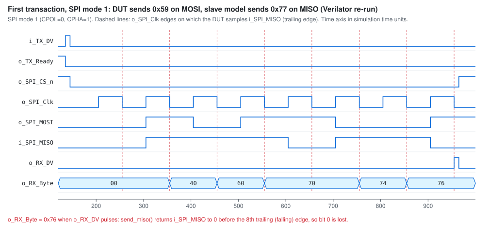

# SPI Modes 0–3: Protocol, RTL and Testbench Behaviour


*Conceptual timing reference. It is drawn from the protocol definition and
the RTL, not captured from simulation.*

## 1. Protocol definition

| Mode | CPOL | CPHA | Idle SCLK | Sampling edge | Data transition edge |
|---|---:|---:|---|---|---|
| 0 | 0 | 0 | Low | Rising (leading) | Falling (trailing) |
| 1 | 0 | 1 | Low | Falling (trailing) | Rising (leading) |
| 2 | 1 | 0 | High | Falling (leading) | Rising (trailing) |
| 3 | 1 | 1 | High | Rising (trailing) | Falling (leading) |

- **CPOL** sets the idle level of SCLK. With CPOL = 0 the leading edge is
  rising; with CPOL = 1 it is falling.
- **CPHA** sets which edge samples data. CPHA = 0 samples on the leading
  edge, so the first bit must already be on the line before that edge.
  CPHA = 1 launches data on the leading edge and samples it on the
  trailing edge.

## 2. How the DUT implements the modes (`rtl/SPI_Master.v`)

```verilog
assign w_CPOL = (SPI_MODE == 2) | (SPI_MODE == 3);
assign w_CPHA = (SPI_MODE == 1) | (SPI_MODE == 3);
```

| Behaviour | RTL mechanism |
|---|---|
| Idle clock level | `r_SPI_Clk` and `o_SPI_Clk` reset to `w_CPOL`. |
| Edge generation | `r_SPI_Clk_Edges` is loaded with 16 on `i_TX_DV`. `r_Leading_Edge` pulses at count `CLKS_PER_HALF_BIT-1` and `r_Trailing_Edge` at `2*CLKS_PER_HALF_BIT-1`. |
| MOSI, CPHA = 0 | Bit 7 is placed on `o_SPI_MOSI` one cycle after `i_TX_DV` (`r_TX_DV & ~w_CPHA`). Bits 6..0 change on `r_Trailing_Edge`. |
| MOSI, CPHA = 1 | Every bit changes on `r_Leading_Edge`. |
| MISO capture | `o_RX_Byte[r_RX_Bit_Count] <= i_SPI_MISO` on `r_Leading_Edge & ~w_CPHA` or `r_Trailing_Edge & w_CPHA`. |
| Bit order | MSB first: both bit counters start at `3'b111` and count down. |
| Alignment | `o_SPI_Clk` is registered from `r_SPI_Clk`, so the pin toggles one `i_Clk` after the internal edge strobe. MOSI updates and MISO capture therefore land on the same `i_Clk` edge as the visible `o_SPI_Clk` transition. |

With the testbench parameters (`CLKS_PER_HALF_BIT = 5`, `MAIN_CLK_DELAY = 5`
⇒ `i_Clk` period = 10 time units), one SCLK period is 10 `i_Clk` cycles =
100 time units, and one byte (16 edges) takes 80 `i_Clk` cycles.

## 3. How the testbench models each mode (`tb/test.sv`)

| Mode | `send_miso()`: when the slave model changes `i_SPI_MISO` | `check_mosi()`: edge used to sample `o_SPI_MOSI` | DUT MOSI launch edge | DUT MISO sample edge |
|---|---|---|---|---|
| 0 | Bit 7 right after CS_n falls, then after each **negedge** | **posedge** | start, then falling | rising |
| 1 | After each **posedge** | **posedge** | rising | falling |
| 2 | Bit 7 right after CS_n falls, then after each **posedge** | **negedge** | start, then rising | falling |
| 3 | After each **negedge** | **negedge** | falling | rising |

`send_miso()` has two code paths:

```systemverilog
if ((SPI_MODE == 0) || (SPI_MODE == 2)) begin   // CPHA = 0
  // drive bit 7 immediately, then one bit after each trailing edge
end else begin                                   // CPHA = 1 (modes 1, 3)
  drive_on_posedge = !((SPI_MODE == 0) || (SPI_MODE == 3)); // 1 → posedge, 3 → negedge
  for (int i = 7; i >= 0; i--) begin
    if (drive_on_posedge) @(posedge spi_io.o_SPI_Clk);
    else                  @(negedge spi_io.o_SPI_Clk);
    spi_io.cb.i_SPI_MISO <= miso_data[i];
  end
  @(spi_io.cb);
  spi_io.cb.i_SPI_MISO <= 0;
end
```

The CPHA = 0 path also contains `cpol/cpha` sub-branches for `(0,1)` and
`(1,1)`. These can never execute, because only modes 0 and 2 enter that path.

The report summarises the driver as "Mode 0: drive on falling, sample on
rising; Mode 1: drive on rising, sample on falling; Mode 2: idle high, drive
on rising; Mode 3: idle high, drive on falling". The `send_miso()` drive
edges in the table above match that summary.

### Observations from the audit

1. **`check_mosi()` chooses its edge from CPOL only.** It samples on posedge
   for modes 0/1 and negedge for modes 2/3, which is always the *leading*
   edge. For CPHA = 0 that is the correct sampling edge. For CPHA = 1 it is
   the edge on which the DUT *launches* the bit. The check still passes
   because `o_SPI_Clk` and `o_SPI_MOSI` are both nonblocking updates on the
   same `i_Clk` edge, so the thread resumed by `@(posedge o_SPI_Clk)` reads
   the new MOSI value. That works, but it depends on same-timestep update
   ordering rather than the protocol sampling point.
2. **CPHA = 1 slave model releases MISO before bit 0 is sampled.** After
   driving bit 0 on the 8th leading edge, `send_miso()` waits one `i_Clk`
   (`@(spi_io.cb)`) and drives `i_SPI_MISO <= 0`. The DUT samples bit 0 on
   the 8th trailing edge, `CLKS_PER_HALF_BIT` (= 5) `i_Clk` cycles later.
   So in modes 1 and 3 the DUT always receives bit 0 as `0`. `check_rx()`
   accepts `expected - 1`, which hides this for odd bytes. See
   [results.md, known issues](results.md#known-issues) and the waveform
   below.



*Re-simulation of the first transaction with Verilator 5.48 from the
reconstructed sources (see [results.md](results.md#open-source-re-run)).
`i_SPI_MISO` falls before the last dashed (trailing-edge) sample point, and
`o_RX_Byte` ends at `0x76` instead of `0x77`.*


*Same transaction in mode 0. All eight MISO bits are stable at the
leading-edge sample points and `o_RX_Byte = 0x77`.*

## 4. Simulation evidence per mode

| Mode | Tested | Expected | Observed (Questa transcript) | Status |
|---|---|---|---|---|
| 0 | Yes, 5 transactions, 17 bytes each direction | Every MOSI byte and every RX byte matches | 17 × `PASS: MOSI correct`, 17 × `PASS: RX data correct`, no FAIL lines | Passed |
| 1 | Yes, same stimulus (same seed) | Same | Same PASS pattern, no FAIL lines | Passed, but RX bit 0 is not validated (known issue 2) |
| 2 | Yes, same stimulus | Same | Same PASS pattern, no FAIL lines | Passed |
| 3 | Yes, same stimulus | Same | Same PASS pattern, no FAIL lines | Passed, but RX bit 0 is not validated (known issue 2) |

Evidence: `results/logs/mode<N>_transcript_*.png` and
`results/waveforms/mode<N>_waveform_questa.png`. Mode was selected by
changing `SPI_MODE` in `spi_test_top`. The UCDB names
`spi_cov_mode<N>.ucdb` in the transcript command lines confirm one run per
mode.
